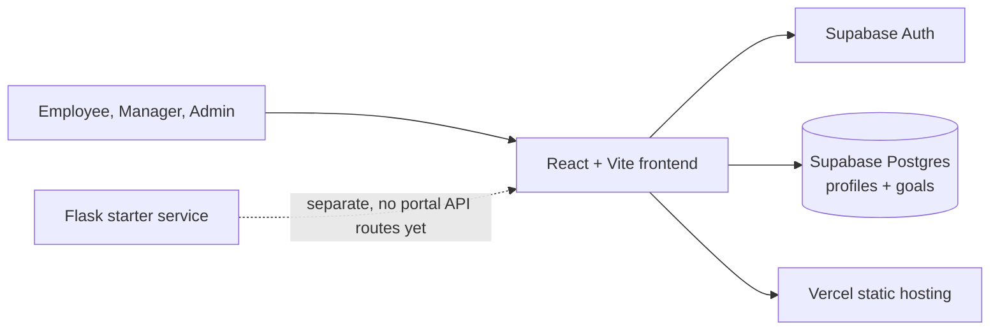

# Goal Tracking Portal

**A role based workspace for setting goals, reviewing progress, and keeping teams aligned.**

The portal gives employees a place to define measurable goals, managers a focused review queue, and administrators a view of users and organization wide goal activity. The application uses Supabase Auth and Postgres for identity and data, React for the web client, and Vercel for frontend hosting.

## What it does

| Role | Workspace |
| --- | --- |
| Employee | Create goals, track progress, view review status and feedback, and manage profile details. |
| Manager | Review submitted goals, approve or reject them, leave feedback, and monitor team progress. |
| Administrator | Review registrations, manage roles, search users, and view goal and platform summaries. |

All role workspaces use the same goal lifecycle: **Pending → Approved / Rejected → Completed**. New self-service registrations are employees and start in pending approval.

## Product direction

The interface uses a restrained company dashboard style: quiet neutrals, clear hierarchy, compact status indicators, and responsive role workspaces. Demo access cards on the sign-in page make it easy to select an evaluation account once the matching Supabase Auth users have been created.

## Architecture



The detailed system map, routes, data model, access rules, and deployment notes are in [brain.md](brain.md).

## Run locally

Requirements: Node.js with npm, a Supabase project, and Git.

1. Install frontend dependencies: `cd frontend` then `npm install`.
2. Copy `frontend/.env.example` to `frontend/.env.local` and set the Supabase project URL and anon/publishable key.
3. Start Vite with `npm run dev` from `frontend`.
4. Open the local URL printed by Vite.

The Supabase key used by the browser must be the public anon/publishable key. Never put a service role key in a `VITE_` variable or in frontend code.

## Supabase setup

The client expects these tables and fields:

- `profiles`: `id` (same UUID as `auth.users.id`), `full_name`, `email`, `role` (`admin`, `manager`, `employee`), `department`, and `approval_status` (`pending`, `approved`, `rejected`). Profile `id` is used to look up the signed-in user's role.
- `goals`: `id`, `user_id`, `title`, `description`, `target_date`, `status`, `progress`, `feedback`, and `created_at`. Goal status values are `pending`, `approved`, `rejected`, and `completed`.

Apply Row Level Security policies that match the role model before using real employee data. Employees should only create and update their own goals. Managers and administrators need only the read/write access their workflows require. Profile role changes and approval status changes must be restricted to administrators. The frontend role checks support navigation and usability; database policies are the security boundary.

For email-confirmation signup flows, configure a trusted `auth.users` trigger to create the pending employee profile. Signup stores the name and department in Auth metadata, but a client without a confirmed session cannot insert into a protected `profiles` table. Create the demo users in Supabase Auth, add corresponding approved profile rows with the correct roles, and set their email/password values in the local and Vercel environment settings below.

## Environment variables

Set these in `frontend/.env.local` for local development and in Vercel's project environment settings for deployment:

| Variable | Purpose |
| --- | --- |
| `VITE_SUPABASE_URL` | Supabase project URL |
| `VITE_SUPABASE_ANON_KEY` | Supabase public anon/publishable key |
| `VITE_DEMO_ADMIN_EMAIL` / `VITE_DEMO_ADMIN_PASSWORD` | Optional admin evaluation account |
| `VITE_DEMO_MANAGER_EMAIL` / `VITE_DEMO_MANAGER_PASSWORD` | Optional manager evaluation account |
| `VITE_DEMO_EMPLOYEE_EMAIL` / `VITE_DEMO_EMPLOYEE_PASSWORD` | Optional employee evaluation account |

Demo credentials are embedded in the browser bundle. Use dedicated, non-sensitive demo accounts and passwords only; do not reuse personal or production credentials. If a role's demo values are unset, its card explains which values are missing.

## Deploy to Vercel

Import the repository in Vercel and configure the frontend project with **Root Directory** `frontend`, **Build Command** `npm run build`, and **Output Directory** `dist`. Add the Supabase and optional demo environment variables, then deploy. `frontend/vercel.json` rewrites browser routes to the SPA entry point so role routes can load directly.

The Flask app in `backend/app.py` currently exposes only a health-style root response. It is retained as a separate starter service and is not required by the deployed frontend; Supabase is the current data and auth service.

## Repository map

```text
frontend/                 React + Vite single-page application
  src/pages/              Login, signup, role dashboards, profile
  src/supabase/            Supabase browser client
  vercel.json              SPA route rewrite
backend/app.py             Minimal Flask service starter
brain.md                   Project architecture and behavior reference
```

## Useful commands

Run from `frontend/`:

```sh
npm run dev       # local development
npm run build     # production bundle
npm run preview   # serve the production bundle locally
npm run lint      # ESLint
```

## Current boundaries

- Supabase provides production identity and persistence; the Flask service has no goal API yet.
- Demo access requires actual Supabase Auth users and approved `profiles` rows; the role cards do not create accounts.
- Signup approval and data access depend on correct database policies and profile provisioning.
- Password recovery and social sign-in are not configured.

## Project links

- Live site: [atomber-gsolution.vercel.app](https://atomber-gsolution.vercel.app/)
- Repository: [ATOMBERGsolution](https://github.com/shreykulkarni13/ATOMBERGsolution)

---

Built by **Shrey Kulkarni**.
