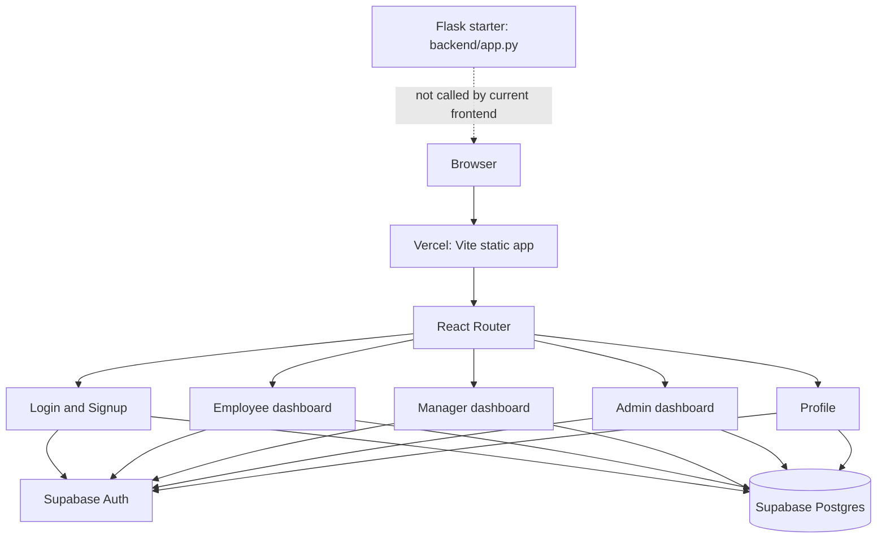

# Project Brain — Goal Tracking Portal

This document records the architecture and runtime behavior of the repository as implemented. Update it when routes, data ownership, role rules, or deployment responsibilities change.

## Product model

The portal is a company goal tracking workspace with three roles:

- **Employee:** create goals, read own goals, update progress, mark an approved goal complete, and edit profile details.
- **Manager:** review goals, set status, and add feedback. Current manager queries operate across the `goals` table; organization/team membership scoping is not represented in the frontend model.
- **Admin:** see users and goals, approve/reject registrations, promote/demote roles, and review summary counts.

New accounts submitted through the signup form are assigned the `employee` role and `pending` approval status. Login rejects pending and rejected profiles. A profile role selects the user's workspace.

## System map

## Frontend structure

- `frontend/src/main.jsx` loads global CSS and mounts `App` inside React Strict Mode.
- `frontend/src/App.jsx` declares browser routes and imports role pages and the shared restrained dashboard theme.
- `frontend/src/pages/Login.jsx` signs in through Supabase Auth, reads the user's profile, enforces approval, and routes by role. Demo cards fill credentials configured by `VITE_DEMO_*` variables.
- `frontend/src/pages/Signup.jsx` creates an Auth user with name and department metadata and attempts to create a pending employee profile when an Auth session exists.
- `frontend/src/pages/Dashboard.jsx` is the role redirect route for `/dashboard`.
- `EmployeeDashboard.jsx`, `ManagerDashboard.jsx`, and `AdminDashboard.jsx` own their role-specific Supabase queries and mutations.
- `Profile.jsx` loads and edits the signed-in user's profile and lists that user's goals.
- `frontend/src/supabase/supabaseClient.js` creates the browser client using Vite environment variables with session persistence and refresh enabled.

The app is a client-rendered SPA. `frontend/vercel.json` rewrites deep links to `/` so React Router can resolve them.

## Routes

| Path | Page | Intended access |
| --- | --- | --- |
| `/` | Login | Public |
| `/signup` | Signup | Public |
| `/dashboard` | Role redirect | Signed-in user |
| `/employee` | Employee workspace | Employee |
| `/manager` | Manager workspace | Manager |
| `/admin` | Admin workspace | Admin |
| `/profile` | Profile | Signed-in user |

The role pages perform client-side session/profile checks. These checks are not a substitute for Supabase Row Level Security. Use database policies for access control and direct API protection.

## Data model inferred from client queries

### `profiles`

| Field | Usage |
| --- | --- |
| `id` | Auth user UUID; primary lookup key |
| `full_name` | Display name and profile editor |
| `email` | Account display/search |
| `role` | `employee`, `manager`, or `admin` |
| `department` | User grouping and profile display |
| `approval_status` | `pending`, `approved`, or `rejected` |
| `created_at` | Joined date in the profile UI |

### `goals`

| Field | Usage |
| --- | --- |
| `id` | Goal identity |
| `user_id` | Owning Auth user UUID |
| `title`, `description` | Goal content |
| `target_date` | Goal target |
| `status` | `pending`, `approved`, `rejected`, or `completed` |
| `progress` | Numeric percentage, from 0 to 100 |
| `feedback` | Manager review note |
| `created_at` | Recent goal ordering and display |

The app assumes these tables and relationships already exist. This repository does not currently include schema migrations or generated database types.

## Authentication and authorization flow

1. Supabase Auth validates email and password and persists the session in the browser.
2. The app loads exactly one `profiles` row by `profiles.id = auth user.id`.
3. Missing profile, pending/rejected approval, and unsupported roles stop navigation with an explicit message.
4. Approved role selects the matching dashboard route.
5. Role dashboard reads and writes data with the Supabase browser client. Row Level Security is the required enforcement layer.

For email confirmation signup, Supabase may return no session. In that case the browser cannot insert a row into a protected `profiles` table under the user's identity. A trusted database trigger or equivalent server-side provisioning must create that pending employee row. Signup writes `full_name`, `department`, and `role: employee` to Auth metadata for that purpose. The project currently does not include the trigger migration.

## Persistence and ownership

- Identity and sessions: Supabase Auth.
- Profiles and goals: Supabase Postgres via `supabase-js`.
- UI state: React component state; theme preference currently resets on page reload.
- Backend: Flask currently serves only `/` with a static “Backend Running!” response. It does not own authentication, authorization, goal operations, or deployment routing.

## Hosting and configuration

Vercel should build the `frontend/` project using `npm run build` with output `dist`. SPA rewrites are declared in `frontend/vercel.json`.

Required browser environment variables:

- `VITE_SUPABASE_URL`
- `VITE_SUPABASE_ANON_KEY`

Optional role demo variables:

- `VITE_DEMO_ADMIN_EMAIL`, `VITE_DEMO_ADMIN_PASSWORD`
- `VITE_DEMO_MANAGER_EMAIL`, `VITE_DEMO_MANAGER_PASSWORD`
- `VITE_DEMO_EMPLOYEE_EMAIL`, `VITE_DEMO_EMPLOYEE_PASSWORD`

Any `VITE_` value is readable by every visitor to the deployed app. Demo credentials must belong to dedicated evaluation users with non-sensitive data. The Supabase service role key must never be exposed to the browser.

## Deployment and operations

1. Configure Supabase URL and public anon/publishable key in Vercel project settings.
2. Ensure the Supabase schema, RLS policies, auth redirect URLs, and optional profile provisioning trigger are configured.
3. Create one dedicated Auth user and approved profile row for each demo role. Demo login cards only prefill; they do not create accounts or bypass Auth.
4. Deploy the `frontend/` root directory to Vercel and verify sign-in and direct role-route loads.
5. Deploy Flask separately only if a future API needs it; the current Vercel frontend does not call it.

## Known gaps / candidate improvements

These are findings for product/architecture review, not behavior implemented by this document:

- Add schema migrations, RLS policy definitions, and database types to version control.
- Add trusted profile provisioning for confirmation-enabled signup and define admin bootstrap procedure.
- Scope manager queries and authorization to an explicit team/manager relationship.
- Implement password reset and decide whether social OAuth is part of the supported auth model.
- Persist theme preference and add stronger loading, empty, and service-error states consistently.
- Decide whether the Flask service should become a real API or remain a health endpoint; avoid maintaining duplicate business rules.
- Add automated tests and CI checks for auth/role routing and goal lifecycle behavior.

## Change checklist

When changing the system, keep these aligned:

1. Auth flow and `profiles` provisioning.
2. Role route checks and Supabase RLS policies.
3. `profiles` / `goals` fields and dashboard queries.
4. Local and Vercel environment configuration.
5. This architecture reference and the root README.
